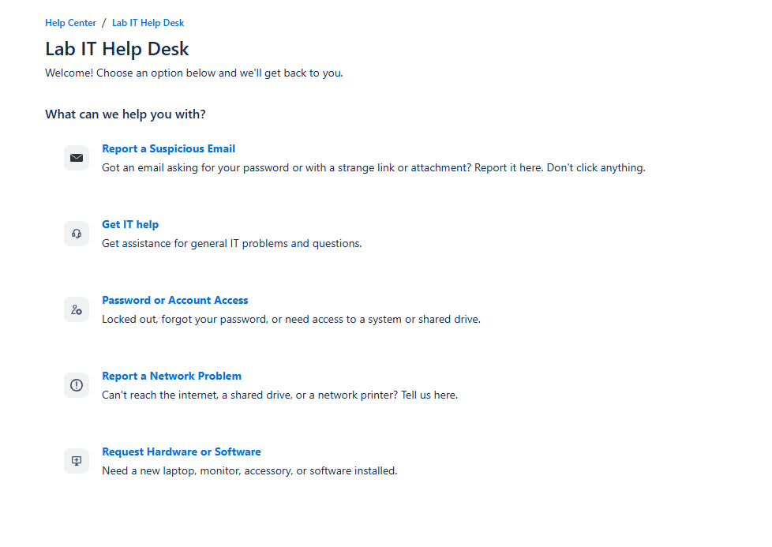
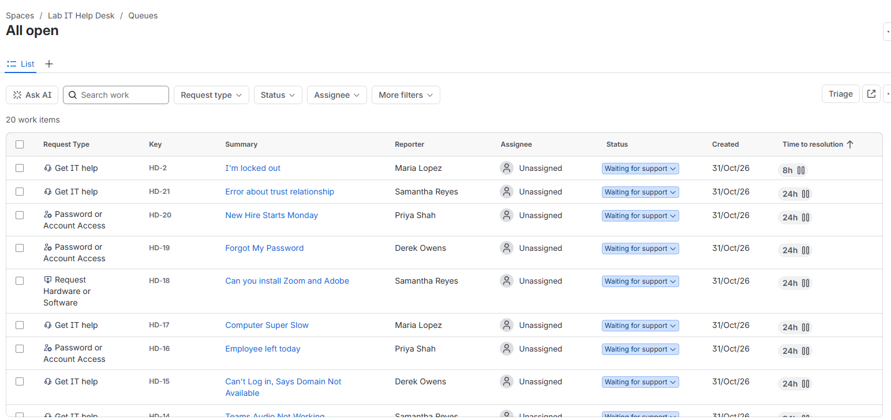
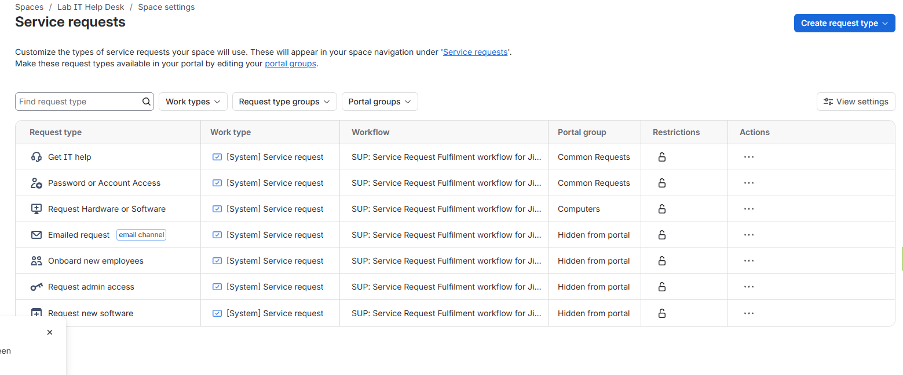
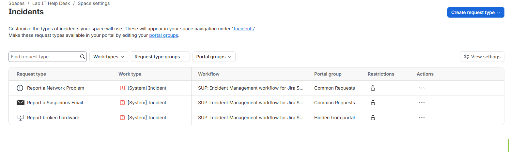
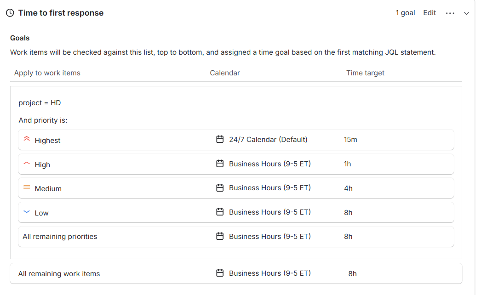
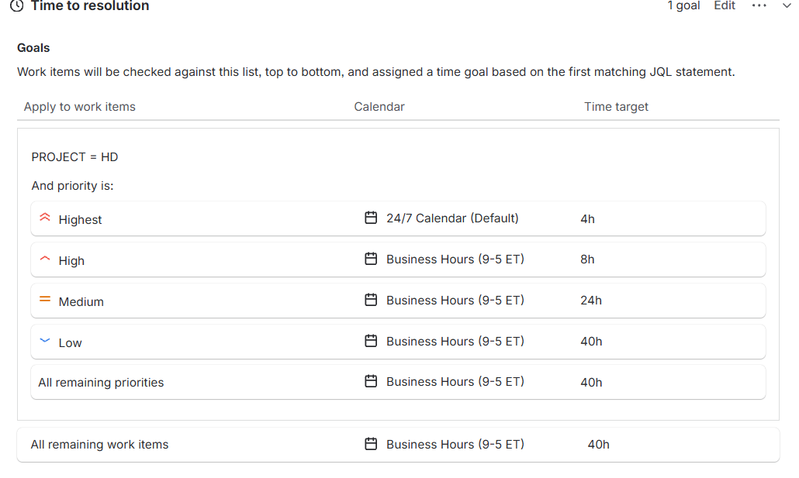
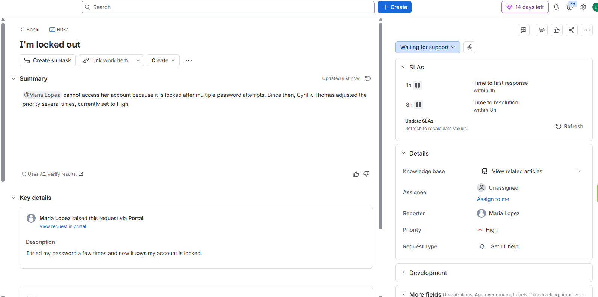
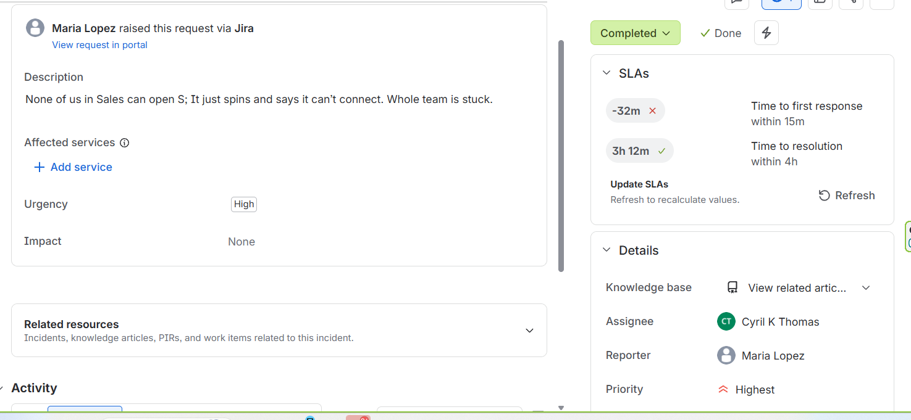
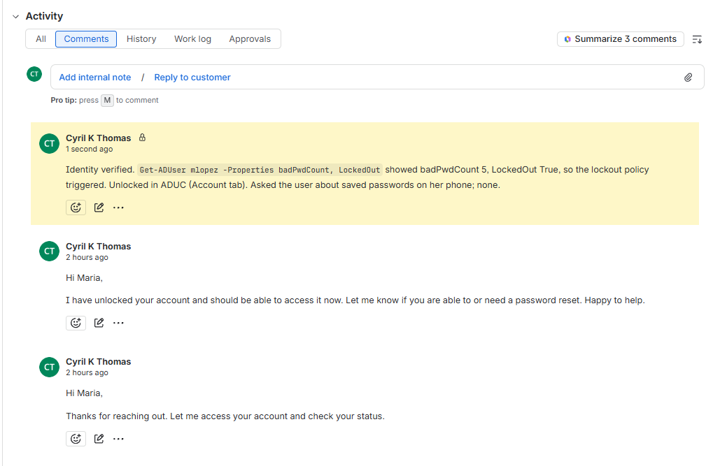
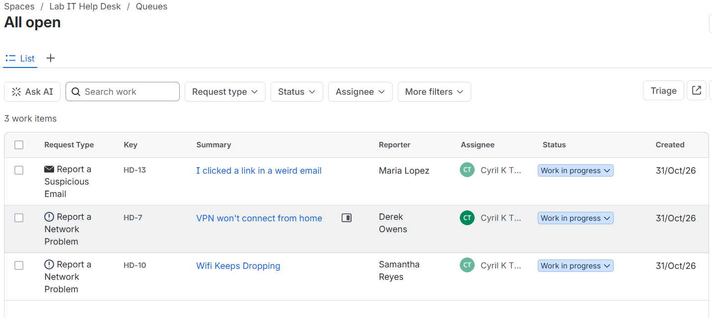

# Help Desk Ticketing Simulation (Jira Service Management)

A working IT service desk built in Jira Service Management: a customer portal, priority-based SLAs on business-hours and 24/7 calendars, and **20 tickets worked end to end** from four employees. Each ticket was triaged, answered with a clarifying question, documented with internal notes, and either resolved or escalated with a handoff note. The most common issues became **8 knowledge base articles**.

It builds on my [Active Directory + Microsoft 365 lab](https://github.com/cyberwithcyril/homelab-ad-m365): the customers are the same fictional company's Microsoft 365 users, and tickets 1-8 replay failures I reproduced and fixed there. Before this, I ran a Jira-based help desk supporting a workforce-management rollout across 550 retail stores.

## What I set up

| Area | Configuration |
| --- | --- |
| Service desk | Jira Service Management, IT support template, space **Lab IT Help Desk** (key `HD`) |
| Customers | 4 employees (Sales, HR, IT) signing in through the customer portal with their Microsoft 365 email addresses |
| Portal | Trimmed to 5 request types, each with plain-language descriptions; template extras hidden |
| SLAs | Time to first response and Time to resolution, goals by priority |
| Calendars | Business hours (Mon-Fri, 9-5 ET) for P2-P4; 24/7 for P1 |
| Workflow change | Added a **Reopen** transition to the Incident workflow so a ticket closed in error could return to Work in progress |
| Escalation | Network and Security teams on the ticket, plus a structured handoff note |

### Portal request types

| Request type | Used for |
| --- | --- |
| Get IT help | General problems and questions |
| Password or Account Access | Lockouts, resets, access changes, new accounts |
| Request Hardware or Software | Equipment and software requests (approval required) |
| Report a Network Problem | Internet, Wi-Fi, VPN, shared drives |
| Report a Suspicious Email | Phishing reports, routed as incidents |

## SLA targets

| Priority | Meaning | First response | Resolution | Calendar |
| --- | --- | --- | --- | --- |
| **P1 Highest** | Many users down (share offline, no internet) | 15 min | 4 hours | 24/7 |
| **P2 High** | One user can't work (locked out, laptop dead) | 1 hour | 8 hours | Business hours |
| **P3 Medium** | Working but impaired (slow PC, printer) | 4 hours | 3 business days | Business hours |
| **P4 Low** | Requests and how-to questions | 1 business day | 5 business days | Business hours |

With a 9-5 calendar Jira counts only working hours, so 1 business day = 8h, 3 = 24h, 5 = 40h. P1 runs 24/7 because an outage at 6 PM shouldn't wait until morning.

## Results

| Outcome | Count | Tickets |
| --- | --- | --- |
| Resolved | 17 | Lockout, resets, department move, drive maps, onboarding, offboarding, DNS, trust relationship, slow PC, printer, Sales outage, monitor, software, Teams audio, laptop, pop-ups, password expiry |
| Escalated | 3 | VPN → Network, Wi-Fi coverage → Network, credential phishing → Security |
| SLA breach (deliberate) | 1 | P1 Sales drive outage: first response missed by 32 min, resolved with 3h 12m to spare |

Full ticket list: [tickets/tickets-export.csv](tickets/tickets-export.csv). Detailed write-ups:

- [P1 outage with a breached SLA](tickets/01-p1-sales-drive-outage.md)
- [Phishing escalation to security](tickets/02-phishing-escalation.md)
- [Department move needing approval](tickets/03-department-move.md)

How I set priority and decide to escalate: [triage-guide.md](triage-guide.md)

## Knowledge base

| Article | Covers |
| --- | --- |
| [Account locked out](kb/01-account-locked-out.md) | Lockout policy, unlocking, repeat lockouts |
| [Reset or change your password](kb/02-password-reset.md) | Self-service change, identity verification, resets |
| [Printer shows offline](kb/03-printer-offline.md) | Stuck jobs, spooler, network printers |
| [Mapped drive missing or denied](kb/04-mapped-drive-missing.md) | Group membership, Group Policy drive maps |
| [Computer running slow](kb/05-slow-computer.md) | Startup apps, disk space, memory |
| [New phone: set up MFA again](kb/06-mfa-new-phone.md) | Authenticator re-registration |
| [Access a shared mailbox](kb/07-shared-mailbox-access.md) | Adding shared mailboxes in Outlook |
| [Wi-Fi keeps dropping](kb/08-wifi-dropping.md) | Reconnecting, drivers, coverage |

## Screenshots

| | |
| --- | --- |
|  |  |
| Customer portal: 5 request types | Agent queue: 20 tickets with priorities and SLA timers |
|  |  |
| Service request types: 3 in the portal, template extras hidden | Incident types: network and suspicious email in the portal |
|  |  |
| Time to first response goals by priority | Time to resolution goals by priority |
|  |  |
| P2 timers paused outside business hours | P1 outage: first response missed by 32 min, resolution met |
|  |  |
| Customer reply and internal note on one ticket | End of shift: only the 3 escalated tickets remain open |

## What I'd point out in an interview

- **Replies vs. internal notes.** Replies are plain language for the user; internal notes are for the next technician. Mixing them up leaks internal details.
- **One clarifying question first.** "Is it just you, or others too?" is what separated a one-user P2 (S: drive missing) from a team-wide P1 outage on the same drive.
- **Escalation is a handoff, not a close.** Escalated tickets stay open with what was reported, checked and ruled out, so the next team doesn't start over.
- **Approvals before spending or access.** Hardware, paid software and access changes waited for manager approval, recorded on the ticket.
- **Owning a missed SLA.** The deliberate P1 breach is documented with cause and prevention.

All names, companies and accounts are fictional lab data.
