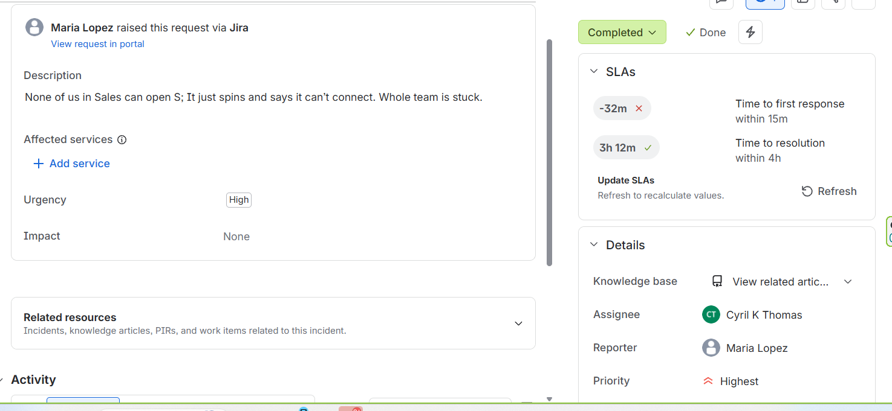

# Ticket write-up: P1 Sales drive outage (SLA breached)

| | |
| --- | --- |
| **Ticket** | "Nobody in sales can open the S drive" |
| **Reporter** | Maria Lopez, Sales |
| **Request type** | Report a Network Problem (Incident) |
| **Priority** | Highest (P1): whole department unable to work |
| **Outcome** | Resolved (simulated outage); first response SLA **breached by 32 min**, resolution SLA **met with 3h 12m to spare** |

## What the user said
> None of us in Sales can open S:. It just spins and says it can't connect. Whole team is stuck.

## Triage
Multiple users on one shared resource = outage, not a single-user problem. Set to **P1**, which runs on the **24/7 calendar** (15 min first response, 4 h resolution).

The first response was deliberately delayed to see how SLA breaches are recorded and reported.

## Reply to customer (clarifying question)
> We're on it. Is anyone in Sales able to open it, and roughly when did it stop working?

## Internal note
> Share/Service Check on DC01; Note: It's an Outage.

This was a **simulated outage**: the share wasn't actually broken in the lab, so no specific root cause was recorded. The note shows the triage call (multiple users = outage) and where to look. On a real ticket, the checks behind that note would be:

| Check | Command | Looking for |
| --- | --- | --- |
| Is the share still published? | `Get-SmbShare -Name Sales` | Share exists and points to `C:\Shares\Sales` |
| Is file sharing running? | `Get-Service LanmanServer` | Server service = Running |
| Are permissions intact? | `icacls C:\Shares\Sales` / `Get-SmbShareAccess -Name Sales` | GG_Sales still has Modify / Change |
| Can a client reach the server? | `Test-NetConnection DC01 -Port 445` | TCP 445 succeeds |
| Is the disk healthy and not full? | `Get-PSDrive C` | Free space available |

Then confirm access with at least two affected users and open a problem record for the root cause.

**What I'd improve:** the internal note should have recorded each check and its result, not just the area investigated. A one-line note forces the next technician to redo the work.

## Breach note (internal)
> First response SLA breached by 32 minutes. Cause: the P1 wasn't picked up until after the 15-minute goal. Outage still resolved within the 4-hour target. Prevention: alert on-call immediately when a P1 is created.

## Closing reply
> The Sales drive is back up. Thanks for your patience, and sorry for the disruption.

## Why it matters
- One clarifying question separated this **team outage (P1)** from a similar-looking **single-user missing drive (P2)** worked the same day.
- A missed SLA, documented with cause and prevention, is how real desks improve. Hiding it helps nobody.

